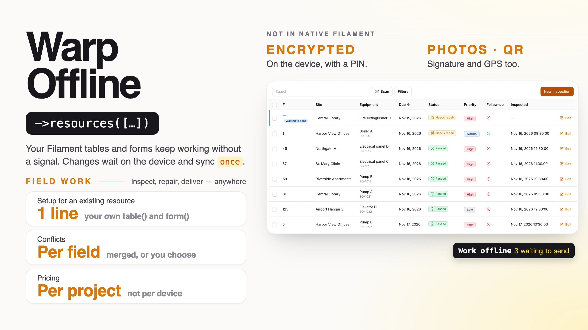
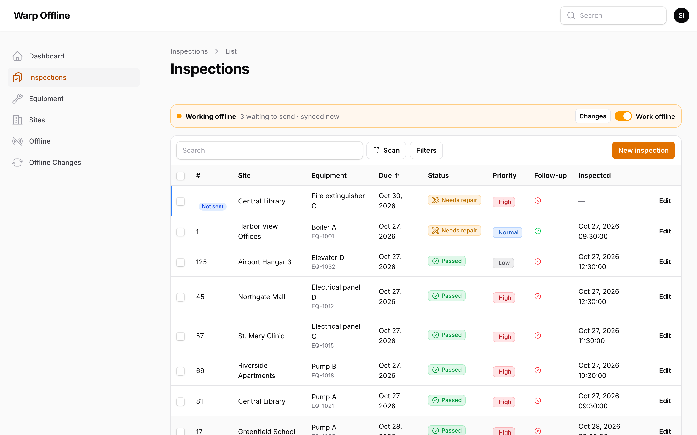
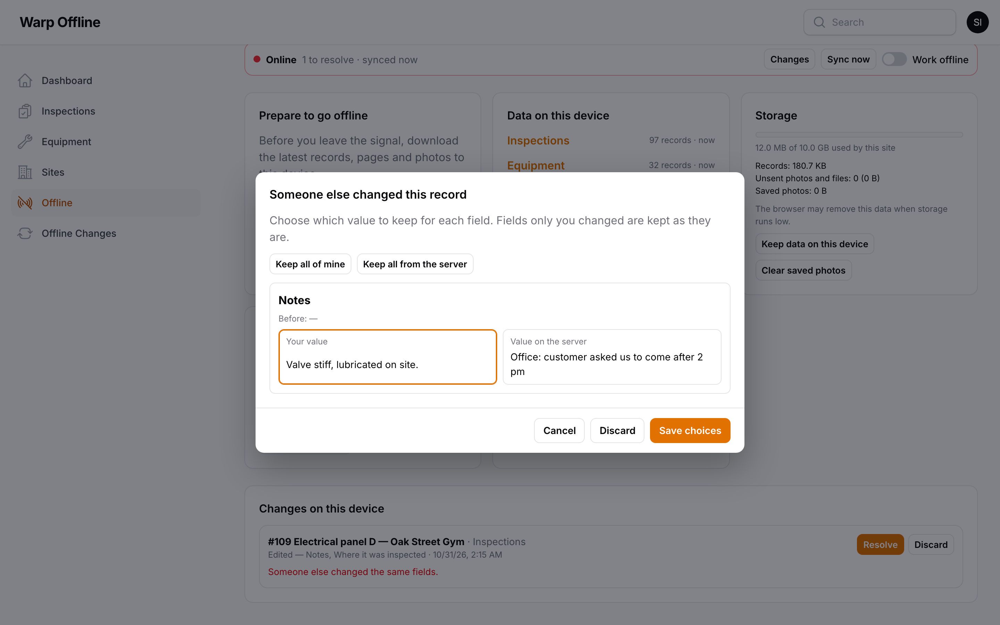

# Warp Offline

**Offline tables and forms for Filament. Field staff keep working without a signal: the records they need are on the device (encrypted), and their edits, new records, photos, signatures and scans wait in a queue until the connection is back — then they are sent once, checked on the server, and conflicts are settled field by field.**

<a href="https://demo.warpui.com/offline"></a>

Switch on airplane mode (or the demo's *Work offline* switch), record an inspection with a photo and a signature, let a colleague change the same record, then come back online and choose what to keep — at **[demo.warpui.com/offline](https://demo.warpui.com/offline)**. No sign-up needed; the data is reset every hour.



- [What it does](#what-it-does)
- [Installation](#installation)
  - [AI coding assistants (Laravel Boost)](#ai-coding-assistants-laravel-boost)
- [Quick start](#quick-start)
- [How it works](#how-it-works)
- [Choosing what goes on the device](#choosing-what-goes-on-the-device)
- [The offline table](#the-offline-table)
- [The offline form](#the-offline-form)
- [Actions that work offline](#actions-that-work-offline)
- [Buttons on any page, offline](#buttons-on-any-page-offline)
- [Viewing a record and its related lists](#viewing-a-record-and-its-related-lists)
- [Sending changes: once, checked, in order](#sending-changes-once-checked-in-order)
- [Conflicts](#conflicts)
- [Changes the server refused](#changes-the-server-refused)
- [Photos and files](#photos-and-files)
- [Field inputs: scan, signature, location](#field-inputs-scan-signature-location)
- [The checklist field](#the-checklist-field)
- [Drawing on a photo (Warp Markup)](#drawing-on-a-photo-warp-markup)
- [Cards and swipes on phones (Warp Mobile)](#cards-and-swipes-on-phones-warp-mobile)
- [The Offline page](#the-offline-page)
- [Protecting the device](#protecting-the-device)
- [Install as an app](#install-as-an-app)
- [The change log](#the-change-log)
- [The device list](#the-device-list)
- [Plugin options](#plugin-options)
- [Recipes](#recipes)
- [Multi-tenancy](#multi-tenancy)
- [Testing it](#testing-it)
- [Limits](#limits)
- [Requirements](#requirements)

## What it does

| | |
| --- | --- |
| **Your resources, offline** | Register a resource and its list page keeps working without a signal. Warp Offline reads your own `table()` and `form()` — the same columns, filters, labels, options and rules — and draws them in the browser from the data on the device. |
| **Search, sort, filter, page** | All of it runs on the device, in the same order as the online table (the default sort, then the primary key). Toggle, checkbox, select and text-input columns can be changed right in the table. |
| **Create and edit offline** | A form slides in with the fields of your resource. Required fields, numbers, lengths, e-mail and URL are checked before saving; unsaved input is kept as a draft if the page closes. |
| **Photos, signatures, scans, location** | Take photos (shrunk on the device before they are sent), sign with a finger, read a QR code or barcode with the camera, record where the work was done. |
| **Inspection checklists** | One field for a whole checklist: *OK*, *Not OK* or *N/A* for each point, with a note and photos where something is wrong. |
| **Sent once, in order** | Every change has its own ID. If the answer is lost on a bad connection and the device sends it again, the server returns the first result instead of creating a second record. Edits of a record created offline travel with its creation. |
| **Conflicts field by field** | Fields only one side changed are merged. When the office changed the same field, the person sees both values and chooses — or you decide in code: the server wins, or the device wins. |
| **Checked like the online form** | Your policies and the form's validation rules run on the server for every change. Refused changes are listed with the reason and can be fixed and sent again. |
| **A record and its history** | Open a piece of equipment without a signal and read its past inspections: the rows of your relation managers travel with each record, as read-only lists under the form. |
| **Only what people need** | Carry “my inspections for the next two weeks”, not the whole table. Records that leave that scope disappear from the device at the next sync. |
| **Encrypted, with a PIN** | Data on the device is encrypted with a key the browser cannot export. Add a PIN (or require one) and the data locks after a while without use. It is deleted on logout, when another user signs in, and after a number of days without syncing. |
| **Prepare to go offline** | One button downloads the latest records, the pages and the photos, and tells people when they are ready to leave the signal. |
| **An app on the home screen** | A web app manifest and a service worker for the panel: install it, open it without a signal, and every page that is not set up for offline use shows a clear offline notice instead of the browser's error. |
| **Every device, at a glance** | An administrator sees who uses which device, how many changes are stuck on it and when it last synced — and can delete the data on a lost device from the office. |
| **A log of every change** | Who changed what, on which device, when it was made on the device (and in which time zone), when it arrived, and what happened. |



## Installation

> **Warp Offline is a commercial plugin.** A license is required. After purchase you receive credentials for the private Composer repository.

Add the repository and authenticate:

```bash
composer config repositories.qalainau composer https://qalainau.privato.pub/composer
composer config --auth http-basic.qalainau.privato.pub "your-email" "your-license-key"
```

Install the package, run the migrations and publish Filament's assets:

```bash
composer require qalainau/filament-warp-offline
php artisan migrate
php artisan filament:assets
```

The migration adds three tables: `warp_offline_changes` (the change log, and what makes repeated sends safe), `warp_offline_uploads` (photos sent from devices) and `warp_offline_devices` (the [device list](#the-device-list); empty unless you switch it on).

Schedule the clean-up of photos that were taken but never used by a saved change, and of old log entries:

```php
// routes/console.php
Schedule::command('warp-offline:prune')->daily();
```

Offline use needs **HTTPS** (browsers only run service workers and encryption on secure origins; `localhost` also works).

### AI coding assistants (Laravel Boost)

Warp Offline ships instructions for AI coding assistants such as Claude Code, Cursor and Codex. If your app uses [Laravel Boost](https://laravel.com/docs/boost), the assistant learns to use the package's offline tables, forms and queued actions instead of building an offline screen and storage from scratch, and how to configure and test them.

- **Guidelines** (`resources/boost/guidelines/core.md`): a short summary that Boost adds to `CLAUDE.md`, `AGENTS.md` and the other agent files.
- **Skill** `warp-offline-development` (`resources/boost/skills/`): examples for resource setup, offline actions, checklists, photos, field inputs, related lists, conflicts, permissions, tenancy, page buttons and Pest tests. The assistant loads it when it works on offline features.

When `php artisan boost:install` asks "Which third-party AI guidelines/skills would you like to install?", select `qalainau/filament-warp-offline`. To do it without the question, add the package to `boost.json` and run the command again:

```json
{
    "packages": ["qalainau/filament-warp-offline"]
}
```

```bash
php artisan boost:install --guidelines --skills -n
```

## Quick start

**1. Register the plugin and your resources** in the panel provider:

```php
use Qalainau\FilamentWarpOffline\FilamentWarpOfflinePlugin;

public function panel(Panel $panel): Panel
{
    return $panel
        // ...
        ->plugin(
            FilamentWarpOfflinePlugin::make()
                ->resources([
                    InspectionResource::class,
                    EquipmentResource::class,
                    SiteResource::class,
                ])
                ->pwa(name: 'Field inspections', shortName: 'Inspections')
        );
}
```

That is all that is needed. Each registered resource's list page now shows a status bar; without a connection the table and the form are drawn from the device.

**2. Optionally, choose what is carried and how** with the `HasOfflineSupport` trait on the resource:

```php
use Illuminate\Database\Eloquent\Builder;
use Qalainau\FilamentWarpOffline\Concerns\HasOfflineSupport;
use Qalainau\FilamentWarpOffline\OfflineAction;
use Qalainau\FilamentWarpOffline\OfflineConfig;

class InspectionResource extends Resource
{
    use HasOfflineSupport;

    public static function offline(OfflineConfig $offline): OfflineConfig
    {
        return $offline
            // Inspectors take their open inspections of the next two weeks with them
            ->query(fn (Builder $query) => $query
                ->where('inspector_id', auth()->id())
                ->whereDate('due_on', '<=', today()->addWeeks(2)))
            // Scanning an equipment label opens its inspection
            ->scanColumn('scanned_tag')
            ->actions([
                OfflineAction::make('passed')
                    ->label('Passed')
                    ->icon('heroicon-m-check-circle')
                    ->color('success')
                    ->set(['status' => 'passed', 'inspected_at' => '@now'])
                    ->visibleWhen(['status' => ['scheduled', 'in_progress']])
                    ->bulk(),
            ]);
    }

    // form() and table() stay exactly as they are
}
```

**3. Before going out, open the Offline page** in the menu and press **Prepare now**.

## How it works

1. **On the server**, Warp Offline builds the resource's table and form the same way the list page does, and turns them into a description the browser can draw: columns (with their labels, badge colors and icons), filters, fields (with options, rules and layout) and actions.
2. **The records** in the offline scope are sent with two things each: the values the form works with (dates as `Y-m-d`, date-times in the field's time zone, file paths, related keys…) and the table's display (formatted dates, badge labels and colors, image URLs) — so the offline table looks like the online one.
3. **In the browser**, the records are stored encrypted in IndexedDB. While online, the normal Filament table is used and the device copy is kept up to date in the background (only records changed since the last sync are sent; a full refresh happens every few hours).
4. **Without a connection** (or with the *Work offline* switch on) the list page hides the Livewire table and shows the offline table and form. Every save goes into a queue on the device and changes the device copy immediately.
5. **When the connection is back**, photos are uploaded first, then the queued changes are sent in the order they were made, then the latest records are read. Each change is checked and applied on the server and the device shows the result.

The service worker keeps the list pages, the Offline page, Filament's CSS and JavaScript and the photos, so the panel opens even when the device is offline from the start. Create and edit URLs of an offline resource open the list page with the form.

## Choosing what goes on the device

```php
$offline
    ->query(fn (Builder $query) => $query->where('assignee_id', auth()->id()))
    ->limit(2000)
    ->fullSyncEvery(hours: 6);
```

| Method | What it does |
| --- | --- |
| `query(Closure)` | Narrows what is carried. It runs after the resource's `getEloquentQuery()` (so tenancy and your own scoping still apply) and after the table's `modifyQueryUsing()`. Records that leave the scope are removed from the device at the next sync — unless the device still has unsent changes for them. |
| `limit(int)` | The most records carried, newest changes first. Default 5000. |
| `fullSyncEvery(hours:)` | Between full refreshes, only records whose `updated_at` changed are sent. A full refresh also catches changes that do not touch `updated_at`, such as the new name of a related record shown in a column. Default 6 hours. |
| `columns(array)` | The columns of the offline table. By default: the table's columns, except those hidden by default. |
| `perPage(int)` | Rows per page in the offline table. Default 25. |

Keep the scope to what a person really needs on the road. Every record is encrypted and stored on the device; thousands of records are fine, hundreds of thousands are not.

## The offline table

- **Search** looks through the searchable columns, the record title and the scan column.
- **Sorting** works on every sortable column: by value for columns that are form fields (numbers as numbers, selects by their label), by the displayed text otherwise.
- **Filters**: `SelectFilter` (single and multiple) and `TernaryFilter` on an attribute. Filters that run their own query cannot run on the device and are not shown offline.
- **Columns**: `TextColumn` (badges, icons, descriptions, lists), `IconColumn`, `ImageColumn`, `ColorColumn`, and the editable `ToggleColumn`, `CheckboxColumn`, `SelectColumn` and `TextInputColumn`. A change in an editable column is a queued change like any other. Other columns show their text. As in the online table, a cell stays on one line unless its column has `wrap()`.
- **Rows changed on the device** are marked *Waiting to send* until the server has them. If the server refuses the change (a rule such as `unique()` fails), the row is marked *Not saved* in red; if someone else changed the same fields, *To resolve*. Records created offline are listed first.
- **Bulk actions**: delete and any `OfflineAction` with `->bulk()`.
- **Dates in changed rows** are written like the other rows: the server sends each date column's format (as a sample written with `date()`, `isoDate()`, `dateTime()`…), and the device writes the new value the same way.
- **Language**: the columns and the rows are in the language of the last sync. After a change of language, the next sync (right away when the page opens online) brings the list again in the new language. Changed while offline, the list stays in the old language until the device is back online.
- **On phones** (below 640px) each row is a short card with the column labels. With [Warp Mobile](#cards-and-swipes-on-phones-warp-mobile), a table with `mobileCards()` gets the same cards and swipes as online instead.

## The offline form

The form uses your resource's `form()`. Sections, fieldsets, tabs and wizard steps become headed groups; grids keep their columns on wide screens and stack on phones.

| Field | Offline |
| --- | --- |
| `TextInput` (text, number, email, tel, url), `Textarea`, `MarkdownEditor` | ✓ with prefix/suffix, min/max, length |
| `Select` (static options, enums, `relationship()` — also `multiple()` on a many-to-many) | ✓ options are carried (up to 1000 for a relationship) |
| `Radio`, `ToggleButtons`, `CheckboxList`, `Checkbox`, `Toggle` | ✓ |
| `DatePicker`, `DateTimePicker`, `TimePicker` | ✓ in the field's time zone, with min/max dates |
| `ColorPicker`, `TagsInput`, `Hidden` | ✓ |
| `FileUpload` | ✓ photos and files wait on the device ([details](#photos-and-files)) |
| `Repeater` (a JSON column, or `relationship()` on a has-many) | ✓ rows are added, removed and reordered offline ([details](#repeater-rows)) |
| `ScanInput`, `Signature`, `Geolocation` (this package) | ✓ ([details](#field-inputs-scan-signature-location)) |
| `Checklist` (this package) | ✓ a result, a note and photos for each point ([details](#the-checklist-field)) |
| `MarkupField` of [Warp Markup](https://warpui.com/markup) (1.4 or later) | ✓ arrows, circles and numbered pins on a photo or a diagram ([details](#drawing-on-a-photo-warp-markup)) |
| Anything else (`RichEditor`, `Builder`, `KeyValue`, custom fields…) | Shown as text, *cannot be changed offline* — the online form still works as usual |

Labels, helper texts (`helperText()`), placeholders, prefixes and suffixes are shown as in the online form; a field with `hiddenLabel()` is drawn without its label. Disabled fields are shown and never sent. Fields that are shown, required or disabled depending on other fields keep doing that offline — see [Fields that depend on other fields](#fields-that-depend-on-other-fields).

**Checks on the device:** required, numeric/integer, min/max, min/max length, e-mail, URL, date ranges and the number of files. **Every rule of the field** (including `unique()`, `exists()`, regexes and your own rules) runs again on the server when the change arrives.

**Drafts:** what is typed is saved on the device as you go. If the page is closed or the battery dies, the form shows *Your unsaved input was restored* the next time it is opened. *Cancel* throws the draft away.

**Your page hooks:** offline changes do not go through the Create and Edit pages, so `mutateFormDataBeforeCreate()` and friends do not run. Do the same work here:

```php
$offline
    ->mutateBeforeSave(fn (array $data, ?Model $record, Operation $operation): array => [
        ...$data,
        'updated_by' => auth()->id(),
    ])
    ->afterSync(function (Model $record, Operation $operation, array $changes): void {
        // runs on the server after a change from a device was saved
    });
```

Model events and observers run as usual.

### Fields that depend on other fields

“Ask what is wrong only when the result is *Failed*” is written in Filament as a closure that reads another field with `Get`:

```php
ToggleButtons::make('status')->options(InspectionStatus::class)->live(),

Textarea::make('defect')
    ->visible(fn (Get $get): bool => in_array($get('status'), [InspectionStatus::NeedsRepair, InspectionStatus::Failed]))
    ->required(fn (Get $get): bool => in_array($get('status'), [InspectionStatus::NeedsRepair, InspectionStatus::Failed])),
```

A browser cannot run PHP, so Warp Offline works the answers out in advance. When it describes the form for the device, it notes which fields the closure reads, puts **every value those fields can have** into the closure, and sends the results as a small table. Offline, the form looks the current values up in that table — the field appears the moment the result is set to *Failed*, with its required mark, and disappears again when the result changes. Nothing has to be written twice.

| Setting | Follows other fields offline |
| --- | --- |
| `visible()`, `hidden()`, `whenTruthy()`, `whenFalsy()` on a field | ✓ |
| The same on a `Section`, `Fieldset`, `Grid`, `Group`, `Tab` or wizard `Step` | ✓ for every field inside |
| `required()` | ✓ (the mark, and the check before saving) |
| `disabled()` | ✓ |
| `options()` of a `Select`, `Radio`, `ToggleButtons` or `CheckboxList` (not `relationship()`) | ✓ the options change with the other field |
| `visibleJs()`, `hiddenJs()` | ✓ the same JavaScript expression is evaluated on the device (`$get('field')`, `$state`) |

**What the closure may read** — the table needs a list of values to try:

| The closure reads… | Offline |
| --- | --- |
| A `Select`, `Radio` or `ToggleButtons` with up to 60 options | ✓ every option, and “nothing chosen” |
| A `Toggle` or `Checkbox` | ✓ on and off |
| A `CheckboxList` or a `Select` with `multiple()` and up to 5 options | ✓ every combination |
| Any other field, asked only **whether it is filled** (`filled($get('amount'))`, `$get('notes') !== null`) | ✓ empty and filled |
| A typed value compared with something (`$get('amount') > 1000`, `$get('code') === 'X'`), a field with more options than above, `$record`, or more than 256 combinations in one condition | ✗ see below |

When a condition **cannot** be turned into a table, the device uses the answer for an empty form (as before this feature), and the server decides when the change arrives. For such a condition, use Filament's own `visibleJs()`, which runs in the browser both online and offline:

```php
TextInput::make('approver')->visibleJs(<<<'JS'
    $get('amount') > 1000
    JS),
```

**On the server**, nothing is taken on trust: when a change arrives, the form's real closures are evaluated with the record's values plus the values sent. A value for a field that is hidden for those values is dropped, a field that is required for them must be filled — also when the change did not touch it (the result was set to *Failed* and the reason is still empty) — and a field that is disabled for them is not changed.

Good to know:

- A hidden field is not sent, so its stored value stays as it is — the same as in Filament's online form.
- Closures that read no other field (`visible(fn () => auth()->user()->is_admin)`) are evaluated once for the signed-in person, as before: a field hidden that way is not sent to the device at all.
- `hiddenOn('edit')`, `visibleOn('create')` and other conditions on the operation are evaluated for *create*, as before: the offline form is the same for creating and editing.
- Fields inside a `Repeater` row are evaluated once per form, not per row.
- A closure is called once per combination when the form is described (on the list page and when the device asks for the schema), so it should only read fields and not have side effects.

### Repeater rows

The parts used on a job, the lines of a work report: a `Repeater` works offline with the fields you gave its rows.

```php
// A JSON column (cast to `array` on the model)
Repeater::make('parts')
    ->schema([
        TextInput::make('name')->required(),
        TextInput::make('quantity')->numeric()->minValue(1)->default(1)->required(),
    ])
    ->columns(2)
    ->defaultItems(0)
    ->maxItems(10)
    ->addActionLabel('Add a part'),

// Or the rows of a has-many relationship
Repeater::make('lines')
    ->relationship()
    ->orderColumn('sort')
    ->schema([
        TextInput::make('work')->required(),
        TextInput::make('minutes')->numeric(),
    ]),
```

Offline, each row is a small card with its fields; **Add** appends a row (with the fields' defaults), **×** removes one, **↑ ↓** change the order. The rows are part of the record's change: they wait on the device with it and are sent together.

| Repeater setting | Offline |
| --- | --- |
| `schema()` with `TextInput`, `Textarea`, `Select`, `Radio`, `ToggleButtons`, `CheckboxList`, `Checkbox`, `Toggle`, `DatePicker`, `DateTimePicker`, `TimePicker`, `ColorPicker`, `TagsInput`, `Hidden`, `ScanInput` | ✓ with their labels, options, defaults and rules |
| Other fields in a row (`FileUpload`, `Signature`, `Geolocation`, a nested `Repeater`…) | Shown as text; their stored values are kept |
| `columns()`, `addActionLabel()`, `minItems()`, `maxItems()`, `defaultItems()`, `simple()` | ✓ |
| `addable(false)`, `deletable(false)` | ✓ the buttons are hidden, and the server refuses a change that adds or removes rows anyway |
| `reorderable(false)` | ✓ no ↑ ↓. A `relationship()` repeater can be reordered when it has an `orderColumn()` |
| `relationship()` | ✓ `HasMany` and `MorphMany`. A many-to-many repeater is shown as text |
| `collapsible()`, `cloneable()`, `itemLabel()`, `table()` | Not used offline: rows are always open cards, numbered |

**Checks.** On the device: the rules listed [above](#the-offline-form) for each field of each row, and the number of rows — the message appears in the row it belongs to. On the server: every rule of every row field, and `minItems()` / `maxItems()`. A repeater without `maxItems()` accepts up to 500 rows per change.

**Relationship rows.** A row from the server carries its key. When the change arrives, rows with a key of *this record's* relationship are updated, rows without one are created, rows that are missing are deleted, and the order column is renumbered. A key that belongs to another record's row is ignored (the row is created as new for this record), so a changed request cannot touch other records. Only the fields of the row schema are written (`fill()`, so the related model's `$fillable` applies).

**Conflicts.** The rows of one repeater count as one field: if the office changed any row while the person changed any row, both versions are shown (each row by its values) and the person keeps one of them.

Good to know:

- The relationship rows are loaded with the records (one extra query per sync, not one per record).
- `mutateRelationshipDataBeforeCreateUsing()`, `mutateRelationshipDataBeforeSaveUsing()` and the repeater's `afterCreate()` / `afterUpdate()` / `afterDelete()` hooks are Livewire-side and do not run for offline changes; use model events or [`afterSync()`](#the-offline-form).
- Conditions inside a row that read other fields (`visible(fn (Get $get) => $get('type') === 'other')` on a row field) are evaluated once for the form, not per row.
- A change to a row's related record made elsewhere does not touch the parent's `updated_at`, so the device sees it at the next full refresh ([`fullSyncEvery()`](#choosing-what-goes-on-the-device)) — or let the related model `touch` its parent.

## Actions that work offline

Custom Filament actions run code on the server and cannot run without it. For the common case — “mark as done”, “start”, “needs repair” — an `OfflineAction` sets values on the device right away and sends them like an edit:

```php
OfflineAction::make('done')
    ->label('Mark as done')
    ->icon('heroicon-m-check')
    ->color('success')
    ->set(['status' => 'done', 'done_at' => '@now', 'done_by' => '@user'])
    ->visibleWhen(['status' => ['open', 'in_progress']])
    ->requiresConfirmation()
    ->bulk()
    ->using(fn (Model $record) => $record->customer->notify(new WorkDone($record)));
```

| Method | |
| --- | --- |
| `set(array)` | The values to put in the columns. `@now` is the moment it was pressed, `@today` the date, `@user` the signed-in user's key (filled in on the server). |
| `visibleWhen(array)` | Show the action only on rows whose fields have one of the given values. |
| `bulk(onlyBulk: false)` | Also offer it for the selected rows. |
| `requiresConfirmation()` | Ask first. For one record the question names it (its `recordTitleAttribute`), for several it says how many. |
| `using(Closure)` | Runs on the server after the values were saved. |

Only the values defined on the server are applied — the device cannot use an action to change other fields.

**How `set()` is applied.** The server takes the values from the action's definition when the change arrives, not from the request:

- A column does not have to be a field of the form. `set(['status' => 'done', 'locked' => true])` sets `locked` even when the form has no `locked` field, or has it disabled. Columns that are editable fields of the form are checked by the form's rules like an edit, and take part in [conflicts](#conflicts); the others are set as they are. Both go through `mutateBeforeSave()`. As with every save, a column that the model does not allow to be mass-assigned (`$fillable`) is not set.
- `@now` is the time the button was pressed on the device (the device's clock, sent with the change). The server checks that it is a time — not readable or more than 5 minutes in the future becomes the server's time — and stores it like the form would: a `DateTimePicker` converts it from its time zone, any other field or column (a `Hidden` field, a column outside the form) gets it in the app's time zone (`config('app.timezone')`, usually UTC). `@today` is that day in the panel's time zone (`FilamentTimezone`).
- Rows the person cannot edit (the resource's `canEdit()` for that record) do not show the action, and the server refuses it.

**The same buttons online.** An `OfflineAction` only appears in the offline list. To offer the same button in the normal Filament table, turn the actions into Filament actions — same label, icon, color, confirmation, `visibleWhen()` and `set()`, applied the same way as a sync (permissions, the form's rules, `mutateBeforeSave()`, `using()`, `afterSync()`), with `@now` as the server's time:

```php
public static function table(Table $table): Table
{
    return $table
        ->columns([...])
        ->recordActions([
            ...static::offlineActions(),   // from HasOfflineSupport: the actions of offline()
            EditAction::make(),
        ]);
}
```

| Method | |
| --- | --- |
| `HasOfflineSupport::offlineActions()` | All the resource's offline actions as Filament row actions (`Filament\Actions\Action`). |
| `OfflineAction::toAction(?string $resource = null)` | One of them. Without `$resource`, the resource of the page it is on. Hidden on records the person cannot edit or that do not match `visibleWhen()`. |
| `OfflineAction::run(string $resource, Model $record)` | Apply it in your own code (a header action of the edit page, a job). Returns `['status' => 'applied' \| 'rejected', 'message' => …, 'errors' => […]]`. |

The notification after a press says *Saved*. Give the action its own words with `->successNotificationTitle('On the way')` or `->successNotificationTitle(fn (Visit $record) => "Visit {$record->number} is on the way")`; the closure gets the record after the values are in. Offline, the device shows the sync state instead, so this is used online only.

Bulk actions are not converted; for the online table, write a Filament `BulkAction` that calls `run()` for each record.

## Buttons on any page, offline

Use `OfflinePageAction` on a regular Filament Page, in schema `Actions` or in header actions. A press made without a signal waits in the device's existing encrypted outbox, with the time it was pressed, and runs on the server when connected again.

```php
use Filament\Pages\Page;
use Qalainau\FilamentWarpOffline\Actions\OfflinePageAction;
use Qalainau\FilamentWarpOffline\Concerns\HasOfflineActions;
use Qalainau\FilamentWarpOffline\OfflinePress;
use Qalainau\FilamentWarpOffline\Schemas\Components\OfflinePendingPresses;

class TimeClock extends Page
{
    use HasOfflineActions;

    public function offlineState(): array
    {
        return ['working' => $this->openRecord() !== null];
    }

    public function clockInAction(): OfflinePageAction
    {
        return OfflinePageAction::make('clockIn')
            ->label('Clock in')
            ->icon('heroicon-o-play')
            ->visibleWhen(['working' => false])
            ->setState(['working' => true])
            ->using(fn (OfflinePress $press) => app(ClockIn::class)->handle(
                $this->employee(), $press->at, offline: $press->offline,
            ));
    }

    public function clockOutAction(): OfflinePageAction
    {
        return OfflinePageAction::make('clockOut')
            ->label('Clock out')
            ->requiresConfirmation()
            ->visibleWhen(['working' => true])
            ->setState(['working' => false])
            ->using(fn (OfflinePress $press) => app(ClockOut::class)->handle(
                $this->employee(), $press->at, offline: $press->offline,
            ));
    }

    public function content(\Filament\Schemas\Schema $schema): \Filament\Schemas\Schema
    {
        return $schema->components([
            \Filament\Schemas\Components\Actions::make([
                $this->clockInAction(), $this->clockOutAction(),
            ]),
            OfflinePendingPresses::make(),
        ]);
    }
}
```

Register the page on your panel. Define each button in a public `<name>Action()` method returning `OfflinePageAction`, with no required parameters and a declared return type of `OfflinePageAction`; synchronizing resolves that method from the page slug, without a tenant prefix. The current panel, page access, action authorization, `visible()` / `hidden()` and `visibleWhen()` are checked on the server. Each UUID runs once; resending returns its previous result. Business changes and the change log are saved in one transaction.

`offlineState()` supplies the server's initial state. It must calculate that state without relying on `mount()`: synchronization creates a fresh page and does **not** mount it. `visibleWhen()` compares values as strings; an array accepts any listed value. These conditions hide the button's wrapper, keeping both buttons in the HTML so the device can switch them. Filament's `visible()` remains an application condition. `setState()` overlays values on the device after a press; it never supplies business data to the server. Pending presses are overlaid in order, including after reopening the page, while rejected presses no longer affect the state. After synchronization the open page refreshes from the server.

`using()` receives `$press`, with `$livewire` and `$page` also available through Filament's named injection. Its return value is ignored. Labels, icons, colors, sizes, confirmation and modal headings work like Filament actions. Online presses run through Livewire and show `successNotificationTitle()` or “Done”; validation and business (`RuntimeException`) failures show an error notification. Offline confirmation uses the same dialog as row actions.

`OfflinePress` is readonly:

| Value | Meaning |
| --- | --- |
| `at` | `CarbonImmutable`, pressed time in the application timezone. Offline uses the device clock; an unreadable time or one more than five minutes ahead becomes server time. |
| `receivedAt` | `CarbonImmutable`, server receipt time in the application timezone. For online presses it equals `at`. |
| `offline` | `true` for a press saved on the device and delivered later, `false` for an online press. |
| `delaySeconds()` | Nonnegative seconds between `at` and `receivedAt`. |
| `device`, `uuid`, `timezone` | Nullable device ID, press UUID and device timezone. Online presses leave these null. |

Save the offline mark and receipt time in your own columns, alongside the pressed time:

```php
->using(fn (OfflinePress $press) => Attendance::create([
    'employee_id' => $this->employee()->id,
    'clocked_in_at' => $press->at,
    'clock_in_offline' => $press->offline,
    'clock_in_received_at' => $press->receivedAt,
]))
```

`OfflinePendingPresses::make()` displays this page's waiting and refused presses using device-local times. They also appear on the Offline page and in the change log, with the page title, button label, pressed time and receipt time. Device timestamps are claims from that device, not proof of attendance time. Old presses are accepted; enforce any age limit in your application handler.

The page also shows the same status bar as the offline lists (above its content), so people see *Working offline* and how many presses are waiting.

A page using `HasOfflineActions` is cached each time it is opened, and included in *Prepare to go offline*. The plugin's service worker only takes over after the first page of the panel has loaded, so the very first visit on a device is not cached: open the page once more, or press *Prepare now*, before relying on it without a signal. Keep business logic usable on an unmounted page and use the authenticated user and current Filament tenant when querying records. No additional plugin migration is needed. Try it on the **Time clock** page of the [live demo](https://demo.warpui.com/offline).

## Viewing a record and its related lists

Field staff often need to *look something up* before they change anything: open a piece of equipment and read what was found at the last three inspections.

**Related lists.** A resource's relation managers are tables of related records. Ask for them in `offline()`, and their rows travel with each record:

```php
class EquipmentResource extends Resource
{
    use HasOfflineSupport;

    public static function offline(OfflineConfig $offline): OfflineConfig
    {
        return $offline->relationManagers(limit: 10);
    }

    public static function getRelations(): array
    {
        return [InspectionsRelationManager::class];
    }
}
```

Offline, each list is shown under the record's form, with the relation manager's title, the columns of its `table()` (labels, dates, badges, icons, images) and its default sort. The lists are **read-only**, and show the rows as they were at the last sync.

| | |
| --- | --- |
| `relationManagers()` | Every relation manager in the resource's `getRelations()` (also inside a `RelationGroup`). |
| `relationManagers([InspectionsRelationManager::class])` | Only these. |
| `relationManagers(limit: 10)` | Rows carried per record and list. Default 20, at most 200. When a record has more, the list says so. |
| `relationManagers(false)` | None (the default). |

What is carried is what the person would see online: the rows come from the relation manager's own table query (so its `modifyQueryUsing()` applies), only for records of the offline scope, and only when the manager's `canViewForRecord()` allows it (by default the related model's `viewAny` policy).

**A read-only view.** When the resource has a `view` page, each row of the offline table has **View** next to **Edit**. *View* opens the record read-only, with the related lists; **Edit** at the bottom switches to the form. The view URL (`/equipment/5`) opens the same thing without a signal. A resource the person may not edit (`readOnly()`, or the policy) opens read-only anyway.

**Records that cannot be edited.** The device knows, for each row, whether the person may edit that record (the resource's `canEdit($record)` — your policy's `update()`, or `getEditAuthorizationResponse()`), as it was at the last sync. A row that cannot be edited — a completed work order, a locked inspection — shows **View** instead of **Edit**, opens read-only, and has no offline actions or editable table cells. The server refuses a change to it in any case.

Good to know:

- The rows are read with one query per record and list when a record is sent to the device, so keep the offline scope and the limit to what people need. Records changed since the last sync are sent again with their lists.
- A new related record does not change its parent's `updated_at`, so the device sees it at the next full refresh ([`fullSyncEvery()`](#choosing-what-goes-on-the-device)) — or sooner if the related model touches its parent (`protected $touches = ['equipment'];`).
- Filters, search, actions and pagination of the relation manager are not available offline, and columns that are editable online (`SelectColumn`, `TextInputColumn`) show their value as text.
- An `infolist()` of the view page is not drawn offline: the read-only view shows the fields of `form()`.

## Sending changes: once, checked, in order

- **Once.** Every change carries a UUID. The server stores the result with it; a change sent twice (the answer was lost, two tabs were open) is not applied twice — the first result is returned.
- **Folded together.** Edits of a record created offline become part of its creation, and deleting it before it was sent removes it without sending anything. Several edits of the same record become one change.
- **In order.** Changes are sent in the order they were made; a record created offline gets its real key before later changes are sent.
- **Checked.** For every change the server checks the resource's `canCreate()`, `canEdit()` and `canDelete()` (your policies), finds the record through the resource's query (so a record of another tenant, or one the user may no longer see, is never touched) and validates the fields.
- **When.** As soon as a connection is detected, when the page becomes visible, after each save while online, and every minute ([`syncInterval()`](#plugin-options)). Chrome also wakes the page up through Background Sync when the connection comes back.

The status bar on each offline list page shows where things stand: *Online*, *Offline — changes are saved on this device*, *3 waiting to send*, *1 not saved by the server*, *1 to resolve*, *synced 2 minutes ago*.

## Conflicts

Each change carries the values of the changed fields *before* the person changed them. The server compares them with what is stored now:

- The server value is still the old one → the change is applied.
- The server already has the same new value → nothing to do.
- Someone else changed **the same field** → conflict.

Fields that only one side changed never conflict; the change of the device is merged into the record and the office's change to other fields stays.

```php
use Qalainau\FilamentWarpOffline\Enums\ConflictStrategy;

$offline->conflicts(ConflictStrategy::Ask);        // default
$offline->conflicts(ConflictStrategy::ServerWins); // keep the office's value, apply the rest
$offline->conflicts(ConflictStrategy::ClientWins); // the device overwrites (last write wins)
```

With **Ask**, nothing of the change is saved. The person sees *Someone else changed this record*, with the value before, their value and the server's value for each field, picks one per field (or *Keep all of mine* / *Keep all from the server*) and saves; the result is sent again against the server's current values.

If the record was **deleted** on the server meanwhile, the person can discard their change or create the record again with their values.

A **delete** of a record that is already gone counts as done. A delete of a record the person can no longer see (another tenant's, or one your resource's query now hides, such as one reassigned to someone else) is refused with *The record no longer exists or you can no longer see it.*, the same message an edit of it gets, and the record stays. The person discards the change in *Changes*.



## Changes the server refused

A change can be refused because a rule only the server can check failed (`unique()`, your own rules) or because a policy says no. The status bar says *1 not saved by the server* in red (the dot keeps showing the connection), a notice replaces *Saved on this device*, and the change stays on the device, listed under *Changes* with the reason. **Fix** opens the form with the server's messages on the fields; saving sends a corrected change. **Discard** removes it and puts the record back as the server has it.

## Photos and files

`FileUpload` fields work offline. Photos taken with the camera button (`accept` image types open the rear camera on phones) or chosen from the device are stored on the device, encrypted, and shown in the form with a *Waiting to send* tag.

- Images are shrunk on the device before sending (longest side 1600 px by default, [`maxImageWidth()`](#plugin-options)), which keeps uploads short on a weak signal.
- When the connection is back, each file is uploaded first — to the field's disk and directory, with the field's visibility, checked against its accepted types and maximum size — and the change then refers to the stored path. Each upload has an ID too: sending it again does not store it twice.
- Files that were uploaded but never used by a saved change (the person discarded the change) are deleted by `warp-offline:prune`.

## Field inputs: scan, signature, location

Three Filament form fields for field work. They work in the normal online form and in the offline form alike.

```php
use Qalainau\FilamentWarpOffline\Forms\Components\Geolocation;
use Qalainau\FilamentWarpOffline\Forms\Components\ScanInput;
use Qalainau\FilamentWarpOffline\Forms\Components\Signature;

ScanInput::make('serial_number')->placeholder('Scan the label'),

Signature::make('customer_signature')->penColor('#1e3a8a'),

Geolocation::make('location')->captureAutomatically(),
```

| Field | Stores | Column |
| --- | --- | --- |
| `ScanInput` | The text read from a QR code or barcode (or typed). Uses the browser's barcode reader where available (Chrome on Android, Safari 17+ on macOS…) and otherwise reads QR codes with a bundled reader. | `string` |
| `Signature` | A PNG image as a `data:` URL. Drawn with a finger, a pen or a mouse; *Sign again* starts over. | `text` / `longText` |
| `Geolocation` | `['lat' => …, 'lng' => …, 'accuracy' => metres, 'at' => ISO 8601]`, from GPS — which works without mobile data. `captureAutomatically()` records it when the form opens. | `json` (cast to `array`) |

`scanColumn('serial_number')` on the offline config also puts a **Scan** button next to the offline table's search: scan a label and the matching record opens.

## The checklist field

An inspection is usually a list of points to tick off: *OK*, *Not OK* or *N/A*, with a note and a photo where something is wrong. `Checklist` is one form field for the whole list. It works in the normal online form and in the offline form alike, and saves into one JSON column.

```php
use Qalainau\FilamentWarpOffline\Forms\Components\Checklist;

Checklist::make('checklist')
    ->items([
        'guards' => 'Guards and covers in place',
        'wiring' => 'Wiring and connections tight',
        'emergency_stop' => 'Emergency stop works',
    ])
    ->required()             // every point needs a result
    ->noteRequiredOnFail()   // "Not OK" needs a note
    ->photos(max: 2)
    ->directory('inspections/checklist'),
```

```php
// migration
$table->json('checklist')->nullable();

// model
protected function casts(): array
{
    return ['checklist' => 'array'];
}
```

Each point is a row with its label and the result buttons. Pressing *Not OK* opens a note field and **Add photo** under that point; for other results, *Add a note or photo* opens them. Pressing the chosen result again clears it.

| Method | Default | |
| --- | --- | --- |
| `items(array\|Closure)` | — | The points: key => label. The key is what is saved, so do not change it later. |
| `itemsFor(string $field, array\|Closure $items)` | — | Points that depend on the record: another field's value => its points. See below. |
| `required()` | off | Every point must have a result. The message names the points that are still open. |
| `noteRequiredOnFail(bool)` | off | A point marked *Not OK* must have a note. |
| `notes(bool)` | on | The note field of each point. |
| `photos(bool, max:)` | on, 3 | Photos for each point, and how many. |
| `notApplicable(bool)` | on | Offer *N/A*. |
| `resultLabels(array)` | *OK*, *Not OK*, *N/A* (translated) | Other words for the buttons: `['ok' => 'Pass', 'fail' => 'Fail', 'na' => 'Skip']`. |
| `disk()`, `directory()`, `visibility()` | Filament's default disk, its root, `public` | Where the photos are stored, as for `FileUpload`. |

**Points that depend on the record.** The device gets one form for every record, so a closure in `items()` cannot read the record there. When the points depend on another field of the same form — a service type, the kind of equipment — give every set with `itemsFor()`:

```php
Checklist::make('checklist')
    ->itemsFor('service_type_id', fn (): array => ServiceType::query()->get()
        ->mapWithKeys(fn (ServiceType $type): array => [$type->id => $type->checklist_items])   // [1 => ['filter' => 'Filter replaced', …], 2 => […]]
        ->all())
    ->items(['general' => 'Looks fine'])   // optional: for a value without its own set
    ->required(fn (Get $get): bool => $get('status') === 'completed'),
```

- The device gets all the sets and picks the one of the field's value, in the list and in the form. Changing the field in the form changes the points at once, offline too. The online form does the same.
- The field (`service_type_id`) can be any field of the form, also a disabled or `Hidden` one. If it is not a field of the form, the device gets the record's value of that column, but the points then cannot change in the form.
- A value without a set (or an empty one) uses `items()`; without `items()` the checklist has no points.
- The server checks and saves with the points of the value that is saved: `required()`, notes, photos, and answers to points of other sets are dropped. Changing the field from a device checks the checklist again, even when the checklist itself was not changed.
- Give the points stable keys (`'filter' => 'Filter replaced'`), as for `items()`: a plain list (`['Filter replaced', …]`) saves `0`, `1`, … and the answers move when the list is reordered.
- Every set goes to the device with the form. Keep it to a few hundred points in all.

**The saved value** has an entry for every point:

```php
[
    'guards' => ['result' => 'ok', 'note' => null, 'photos' => []],
    'wiring' => ['result' => 'fail', 'note' => 'Terminal 4 is loose.', 'photos' => ['inspections/checklist/01JC….jpg']],
    'emergency_stop' => ['result' => null, 'note' => null, 'photos' => []],   // not answered yet
]
```

`result` is `'ok'`, `'fail'`, `'na'` or `null`. `Checklist::count($record->checklist)` returns `['ok' => 1, 'fail' => 1, 'na' => 0, 'open' => 1]` for a table column or a report.

**Photos.** Online, a photo is uploaded as soon as it is chosen (shrunk to 1600 px first). Offline, it waits on the device, marked *Waiting to send*, and is uploaded before the change — like the photos of a `FileUpload` ([details](#photos-and-files)). Images only (PNG, JPEG, GIF, WebP), 12 MB at most.

**Checks** run on the device before saving and again on the server, online and offline alike: results must be one of the offered ones, `required()` and `noteRequiredOnFail()`, the number of photos, and every photo must be a file in the field's `directory()`. A change from a device can only use photos that the same person uploaded to this field, or that the record already has.

Good to know:

- The whole checklist is one field for [conflicts](#conflicts): if the office and the device both changed it, the person keeps one of the two versions (shown as “3 OK · 1 Not OK”).
- Photos that were uploaded but never saved with a record are deleted by `warp-offline:prune` when they came from a device. Photos uploaded in the online form and then abandoned stay on the disk, as with Filament's rich editor attachments.
- Removing a point from `items()` drops its saved answer the next time the record is saved.
- `required()`, `noteRequiredOnFail()` and the other settings can be closures that read other fields (`fn (Get $get) => …`). The device follows them while the form is filled in, and the server evaluates them with the values of the change when it syncs.

## Drawing on a photo (Warp Markup)

*The crack is here*, with an arrow on the photo that was just taken — in a basement, without a signal. Warp Offline has no drawing tool of its own: when [Warp Markup](https://warpui.com/markup) (1.4 or later) is installed too, its `MarkupField` works in the offline form, with the same tools and the same notes under the picture as online.

```php
use Filament\Forms\Components\FileUpload;
use Qalainau\FilamentWarpMarkup\Forms\MarkupField;

FileUpload::make('photos')->image()->multiple()->directory('inspections'),

// Draws on the first photo of the field above — also on one that is still waiting on the device
MarkupField::make('photo_marks')->imageFrom('photos')->tools(['arrow', 'ellipse', 'pin', 'ink', 'text']),

// Or on one fixed picture: a vehicle diagram, a floor plan
MarkupField::make('damage')->image(asset('images/vehicle.svg')),
```

```php
protected function casts(): array
{
    return ['photo_marks' => 'array', 'damage' => 'array'];
}
```

Nothing else is needed: there is no option to switch on in Warp Offline.

- **`imageFrom('photos')`** names a `FileUpload` of the same form. While it is empty the field says *Add a photo first*; as soon as a photo is taken or chosen, it appears in the drawing field. If the first photo is replaced, the marks stay where they were on the picture — remove them with the bin button if they no longer fit.
- **`image('…')`** with a fixed URL: *Prepare to go offline* stores the picture on the device, so the field also opens on a device that has never shown it.
- The marks are part of the record's change: they wait on the device with the other fields, are sent after the photo was uploaded, and take part in [conflicts](#conflicts) like any other field (shown there as *2 marks*).
- On the server, the shapes pass the same check as in the online form (`MarkupField::cleanShapes()`): unknown shape types and broken coordinates are dropped, whatever the device sent. `required()` is checked on the device and again on the server.

Not offline:

- A field whose picture is decided for each record (`->image(fn ($record) => …)`) is shown as text and cannot be changed offline — the device cannot run the closure. Use `imageFrom()` or a fixed URL.
- `pinTypes()`: symbols can be chosen from the list, but the list itself is edited online.
- A `MarkupField` inside a `Repeater` row.
- Markup's workspace (`MarkupPage`: PDF drawings, findings, revisions) is an online page.

## Cards and swipes on phones (Warp Mobile)

*Passed*, with one swipe of a card, in a basement. When [Warp Mobile](https://warpui.com/mobile) is installed too, the offline list follows the resource's `mobileCards()` and `swipeActions()`: on narrow screens the rows are the same cards as online (title, subtitle, badge, picture and the other columns as *Label: value* lines), and swiping a card shows the same buttons. There is nothing to set up in Warp Offline; write the table once:

```php
public static function table(Table $table): Table
{
    return $table
        ->mobileCards()
        // passed and flag are OfflineActions of offline(); edit is the offline form
        ->swipeActions(leading: 'passed', trailing: ['flag', 'edit'])
        ->columns([
            TextColumn::make('site.name')->mobileTitle(),
            TextColumn::make('equipment.name')->mobileSubtitle(),
            TextColumn::make('status')->badge()->mobileBadge(),
            TextColumn::make('due_on')->date(),
        ])
        ->recordActions([...static::offlineActions(), EditAction::make()]);
}
```

Offline, a name of `swipeActions()` becomes:

| Name | Button offline | Shown on a row when |
| --- | --- | --- |
| The name of an [`OfflineAction`](#actions-that-work-offline) (not bulk-only) | The offline action, with its label, icon, color and confirmation | the row can be edited and its `visibleWhen()` matches |
| `edit` | Opens the offline form | the row can be edited |
| `view` | Opens the record read-only | always |
| `delete` | Deletes on the device, after a confirmation | the resource can delete (`canDeleteAny()`) and the row can be edited |
| Any other name (an online-only action) | Not shown offline | — |

Swiping all the way runs the first button of that side, with its confirmation. A row without any button that works offline does not swipe.

Notes:

- The width is Warp Mobile's `->breakpoint()` of the panel (`md` when the panel does not register Warp Mobile). Wider screens keep the plain offline table.
- Names that come from a closure (`swipeActions(leading: fn ($record) => …)`) depend on the record and cannot be decided on the device: that side has no buttons offline. Conditions in `mobileCards(fn () => …)` and the column roles are read when the device downloads the list.
- With a mouse, swiping needs Warp Mobile's `->mouseGestures()`.
- Nothing new is sent to the device but the column roles and the action names, and the buttons go through the same offline actions, form and delete as the rest of the list (the server checks each change when it is sent).
- Adding Warp Mobile, or changing the table, changes the description of the list: devices download it again at their next sync.
- Without Warp Mobile, or for a table without `mobileCards()`, the offline list is exactly as before.

## The Offline page

A page in the panel's menu (*Offline*) for each person's device:

- **Prepare to go offline** — downloads all records again, stores the list pages and the photos, and shows *Ready to work offline*.
- **Data on this device** — each list, how many records, when it was last synced.
- **Storage** — what this site uses on the device, records, unsent photos, saved photos; *Keep data on this device* asks the browser not to clear it when space runs low; *Clear saved photos*.
- **Protect this device** — set, change or remove the PIN, lock now, delete all offline data.
- **Install as an app**.
- **Changes on this device** — waiting, refused and conflicting changes, with *Fix*, *Resolve* and *Discard*.

When a page that is not set up for offline use is opened without a connection, this page is shown instead of the browser's error, so the person can see what is on the device and open the offline lists. If the Offline page has not been stored on the device yet (it is stored when it is opened or when *Prepare now* runs), a short *You are offline* page with a *Try again* button is shown instead.

### Restricting pages per role

Your app may already decide, per role, which screens a person can use and which they may only look at. `canAccessUsing()` and `canWriteUsing()` let it decide the same for the Offline page:

```php
use Qalainau\FilamentWarpOffline\Pages\OfflinePage;

FilamentWarpOfflinePlugin::make()
    ->canAccessUsing(fn (User $user, string $page): bool => $user->canOpen($page))
    ->canWriteUsing(fn (User $user, string $page): bool => ! $user->isReadOnlyOn($page))
```

`$page` is the page class. The plugin has one page: `Qalainau\FilamentWarpOffline\Pages\OfflinePage`.

- **`canAccessUsing()` returns `false`**: the page is not in the menu, its URL answers 403, a page that is already open stops answering (every Livewire call is checked again), and the *Open the Offline page* link on the *You are offline* banner is not shown. *Prepare now* on the other pages then does not store the Offline page on the device either.
- **`canWriteUsing()` returns `false`**: the page still opens. It writes nothing to the database itself — everything on it works on this device (prepare, storage, PIN, delete the offline data). Changes made in the offline lists are still checked by the resources' own policies when they are sent, so `canWriteUsing()` does not change them. `OfflinePage::canWrite()` returns `false` if you want to read it.
- The change log and the device list are resources: use their `canView` options and your policies for them.
- The rules only narrow what the plugin allows (`page(false)`, the resources' `canView`). They cannot open anything more.
- When you give a rule, a guest gets `false` from both.


**Your own policies count too.** When your app has a policy for a model of this plugin, the change log and devices lists (`OfflineChangeResource`, `OfflineDeviceResource`) also asks it (`viewAny`; removing a device also asks `delete`), together with the plugin's own options — so a role that may not use the screen gets a 403 there too. Without a policy nothing changes (also with Filament's `strictAuthorization()`).

## Protecting the device

- **Encrypted.** Records, queued changes, drafts and photos are encrypted (AES-GCM, 256 bit). The key is wrapped by a key the browser keeps and cannot export, so the data cannot be read from the device's disk outside the browser.
- **PIN.** With a PIN, the key is wrapped by the PIN instead (PBKDF2). The data opens for a time after the PIN is entered and locks again after `timeout` minutes without use. After five wrong PINs the data on the device is deleted, and the status bar says so until the device is prepared again or a new PIN is set.
- **Deleted on logout.** Logging out of the panel deletes the device's data and the stored pages. If changes are still waiting, the person is asked first.
- **Deleted when someone else signs in.** If a different user signs in on the device, the previous user's data is deleted before anything is shown.
- **Deleted when not used.** After `expireAfter()` days without a successful sync, the records are deleted; changes not sent yet are kept so no work is lost.

```php
FilamentWarpOfflinePlugin::make()
    ->pin(required: true, timeout: 10)
    ->expireAfter(days: 7)
```

## Install as an app

`->pwa()` adds a web app manifest to the panel. On Android and desktop Chrome the Offline page shows an *Install* button; on iPhone and iPad it explains *Share → Add to Home Screen*. The app opens full screen at the panel's start page, also without a signal.

```php
->pwa(
    name: 'Field inspections',
    shortName: 'Inspections',
    themeColor: '#d97706',
    icon: asset('images/app-icon-512.png'), // 512×512 PNG; an SVG is generated from the panel color if you leave it out
)
```

`->pwa(enabled: false)` leaves out the manifest; the service worker is still used for offline pages.

## The change log

*Offline changes* (in the panel's menu) lists every change sent from a device: when it arrived, when it was made on the device (and how much later it was sent), who, which list and record, the kind of change, the result, and — in the details — the values sent, the values before, conflicts and errors. Only the current panel's (and tenant's) changes are listed.

Times are shown in the panel's display time zone if your app sets one with `FilamentTimezone::set()`. Otherwise they are shown in the time zone of the viewer's browser (the device tells the server with a small cookie, `warp_offline_timezone`), so they match the times in *Changes on this device*.

```php
FilamentWarpOfflinePlugin::make()
    ->changeLog(canView: fn (): bool => auth()->user()->is_admin)
    // ->changeLog(false) to leave it out
```

The log is also what makes repeated sends safe, so keep it for a while; `warp-offline:prune --changes-after=180` deletes entries older than 180 days.

## The device list

Who has offline data on which device — and what to do when a phone is lost.

```php
FilamentWarpOfflinePlugin::make()
    ->devices(canView: fn (): bool => auth()->user()->is_admin)
```

This adds *Offline devices* to the panel's menu. Each device that holds offline data is one row:

| Column | |
| --- | --- |
| **User**, **Device** | Who is signed in on it, and the browser and system (*Chrome · Android*) with the start of the device's ID. |
| **Waiting to send** | Changes that were still on the device the last time it reached the server. |
| **To fix** | Changes the server refused, or that wait for the person to settle a conflict. |
| **Records on the device** | How many records it carries (hidden at first; switch it on in the table's column menu). |
| **Last synced** | The last time everything was sent and read. A device that has not synced for days is one to call. |
| **Status** | *In use*, *Waiting to be deleted*, *Deleted*. |

The numbers are what the device reported **the last time it reached the server** — a device that is offline right now cannot say what was typed since. The filter *With changes not sent yet* shows the devices to chase.

**Delete data on the device.** For a lost or stolen device (the confirmation names the person and the device once more): the next time the device reaches the server — signed in or not — it deletes its records, its unsent changes, its photos and the stored pages, signs out, and tells the person *An administrator deleted the offline data on this device.* Until the device was reached, *Do not delete* takes the request back. A deleted device stays in the list as *Deleted*; when the person prepares the device again, it is listed as a new one.

**Remove from the list** only removes the entry (a device nobody uses any more). The data on the device stays, and the device is listed again at its next sync.

| | |
| --- | --- |
| `devices()` | Switch the list on. Off by default: nothing is recorded, and no menu item is added. |
| `devices(canView: fn () => …)` | Who sees the list. **Whoever sees it can also delete the data on a device**, so give it to administrators only. Without `canView`, everyone in the panel sees it. |
| `devices(false)` | Off. |

Good to know:

- Deleting from afar needs the device to come online with the app open. It cannot reach a device that stays in airplane mode — that is what the [PIN and the expiry](#protecting-the-device) are for. Also change the person's password: deleting the data signs this device out, but does not stop a new sign-in.
- A device reports when it syncs: before sending when changes are waiting, and after every successful sync. One row per browser, panel and tenant.
- In a panel with tenancy (or [`tenantKey()`](#panels-without-tenancy-tenantkey)) the list shows the current tenant's devices only, and a device's report never changes another person's or tenant's row.
- The question a signed-out device asks (`GET {panel}/warp-offline/devices/{id}`) needs no login, by design. The ID is a random UUID the device made up, the answer is only *delete: yes or no*, and the route is limited to 30 requests a minute per address.

## Plugin options

```php
FilamentWarpOfflinePlugin::make()
    ->resources([InspectionResource::class])
    ->navigationGroup('Field work')
    ->page(true)
    ->changeLog(true, canView: true)
    ->devices(true, canView: fn () => auth()->user()->is_admin)
    ->pwa(name: 'Field inspections')
    ->pin(allowed: true, required: false, timeout: 15)
    ->expireAfter(days: 14)
    ->simulateOffline(true)
    ->maxImageWidth(1600)
    ->photoCacheLimit(megabytes: 200)
    ->syncInterval(seconds: 60)
```

| Option | Default | |
| --- | --- | --- |
| `resources(array)` | — | The resources that work offline. |
| `navigationGroup(?string)` | none | Group of the *Offline* page and the change log. |
| `page(bool)` | `true` | The *Offline* page. `false` takes it off. |
| `offlinePage(bool\|string)` | `true` | Replace the *Offline* page with your own class (it must extend `Qalainau\FilamentWarpOffline\Pages\OfflinePage`), or `false` to take it off. See [Your own Offline page](#your-own-offline-page). |
| `changeLog(bool, canView:)` | `true` | The change log and who may see it. |
| `devices(bool, canView:)` | off | The [device list](#the-device-list): unsent changes and last sync per device, and deleting the data on a lost device. |
| `pwa(...)` | on | Web app manifest: name, short name, colors, icon. |
| `pin(allowed:, required:, timeout:)` | allowed, not required, 15 min | With `required: true` nothing is kept on the device until a PIN is set. |
| `expireAfter(?int $days)` | 14 | Delete records after this many days without syncing (`null`: never). |
| `simulateOffline(bool\|Closure)` | `true` | The *Work offline* switch: use the offline table and form while still connected — to check everything is there before leaving, or for training. Nothing is sent while it is on. |
| `maxImageWidth(int)` | 1600 | Longest side of photos after shrinking (0: send as taken). |
| `photoCacheLimit(megabytes:)` | 200 | Photos kept for offline viewing; the oldest are removed first. |
| `syncInterval(seconds:)` | 60 | How often to send and read while online. |
| `tenantKey(?Closure)` | Filament's tenant | The tenant (company) when it is not a Filament tenant. See [Panels without tenancy](#panels-without-tenancy-tenantkey). |

Per resource, in `offline(OfflineConfig $offline)`:

| Method | |
| --- | --- |
| `query()`, `limit()`, `fullSyncEvery()`, `columns()`, `perPage()` | [What is carried](#choosing-what-goes-on-the-device) |
| `relationManagers(bool\|array, limit:)` | [Related lists, read-only](#viewing-a-record-and-its-related-lists) |
| `scanColumn(?string)` | Scan button on the table |
| `actions(array)` | [Offline actions](#actions-that-work-offline) |
| `conflicts(ConflictStrategy)` | [Conflicts](#conflicts) |
| `creatable(bool)`, `editable(bool)`, `deletable(bool)`, `readOnly()` | What may be done offline (your policies still decide on the server) |
| `mutateBeforeSave()`, `afterSync()` | [Your page hooks](#the-offline-form) |

### Your own Offline page

To add your own text, a heading or a view to the *Offline* page (the one with *Prepare now*), extend the page and hand it to the plugin:

```php
use Qalainau\FilamentWarpOffline\Pages\OfflinePage;

class FieldOfflinePage extends OfflinePage
{
    protected string $view = 'pages.field-offline'; // @include('filament-warp-offline::pages.offline') inside it
}

FilamentWarpOfflinePlugin::make()->offlinePage(FieldOfflinePage::class)
```

- The address (`/offline`) and the route name stay the same, so links, the web app manifest and the Service Worker keep working. Do not change `$slug` in the subclass.
- The banner link, the *Prepare now* flow and the offline fallback all point to your page.
- A class that does not extend `OfflinePage` throws an `InvalidArgumentException`. `page(false)` and `offlinePage(false)` take the page off; `page(true)` brings back the standard page (or keeps yours).
- `canAccessUsing()` is asked about your class name, not `OfflinePage`.

## Recipes

### Today's jobs from Warp Scheduler

Warp Scheduler books your own models, so the jobs a technician has today are a resource like any other:

```php
public static function offline(OfflineConfig $offline): OfflineConfig
{
    return $offline
        ->query(fn (Builder $query) => $query
            ->where('technician_id', auth()->user()->technician?->id)
            ->whereBetween('starts_at', [today(), today()->addDays(2)]))
        ->actions([
            OfflineAction::make('arrived')->set(['status' => 'on_site', 'arrived_at' => '@now']),
            OfflineAction::make('done')->set(['status' => 'done', 'finished_at' => '@now'])->requiresConfirmation(),
        ]);
}
```

The schedule board shows the new status as soon as the change arrives.

### My shifts from Warp Shift

Make a small read-only resource over Warp Shift's `Assignment` model (the shifts of the roster, one row per person and day), limit it to the signed-in person, register it, and staff can look up their shifts without a signal:

```php
class MyShiftResource extends Resource
{
    use HasOfflineSupport;

    protected static ?string $model = \Qalainau\FilamentWarpShift\Models\Assignment::class;

    public static function offline(OfflineConfig $offline): OfflineConfig
    {
        $staff = auth()->user()->nurse; // your staff model

        return $offline
            ->readOnly()
            ->query(fn (Builder $query) => $query
                ->where('staff_type', $staff->getMorphClass())
                ->where('staff_id', $staff->getKey())
                ->whereDate('date', '>=', today()));
    }

    // table(): date, shift code, notes
}
```

### Requests that go into a Warp Flow approval

Fill in a request offline (a model with Warp Flow's `HasApprovals`); when it reaches the server, submit it to the approval flow:

```php
$offline->afterSync(function (Model $request, Operation $operation): void {
    if ($operation === Operation::Create) {
        $request->submitForApproval(auth()->user());
    }
});
```

`afterSync()` runs inside the same database transaction as the change: if submitting fails (for example, no flow matches), the change is refused and the person sees Warp Flow's message under *Changes*.

## Multi-tenancy

Warp Offline works in panels with Filament's tenancy without extra setup:

- The endpoints live under the tenant's URL, the resource's query is scoped to the tenant like on the list page, and new records are attached to the tenant the same way the Create page does it.
- Each tenant has its own encrypted database on the device; switching teams never shows another team's records.
- A change for a record of another tenant is treated like a record that does not exist.
- The change log, the uploaded photos and the device list store the tenant (`tenant_type`, `tenant_id`), and the change log and the device list only show the current tenant's rows.

### Panels without tenancy: `tenantKey()`

Some apps know the tenant without Filament's tenancy — for example a staff panel where each employee belongs to one company, and your app has its own "current company". Tell Warp Offline about it:

```php
use App\Support\CurrentTenant;

FilamentWarpOfflinePlugin::make()
    ->resources([DeliveryResource::class])
    ->tenantKey(fn () => CurrentTenant::get()) // a model, a key, or null
```

Then, in that panel:

- Every change in the change log and every uploaded photo is saved with that company.
- The change log lists only that company's changes.
- A photo is only used for a change of the same company, and each company has its own database on the device.

Return the tenant **model** when you can: `tenant_type` is then its morph class, the same pair a panel with Filament tenancy on that model stores, so the rows of both panels belong to the same company. A plain key is stored with the panel's tenant model as the type when the panel has tenancy, otherwise with the type `custom`. `null` means rows without a tenant (and the change log lists only those).

`tenantKey()` only decides the tenant of Warp Offline's own tables. Which records are carried and changed still comes from your resource's `getEloquentQuery()`, so scope your models to the company there (or with a global scope), and set the company on new records (for example in the model's `creating` event), as you do for the panel's normal pages.

Both tables have an index that starts with the tenant (`tenant_type`, `tenant_id`, `created_at`), for the change log and for exporting one company's data.

## Testing it

- **The *Work offline* switch** on each offline list page (and on the Offline page) uses the offline table and form while still connected; create and edit URLs of offline resources open the offline form too. Changes wait until it is switched off.
- **The browser's own offline mode** (DevTools → Network → Offline, or airplane mode on a phone) also tests the service worker: reload, open an edit URL, open a page that is not offline — everything should still show something useful.
- **Automated browser tests** (Playwright): `context.setOffline(true)` turns the network off for the page and its service worker. Requests already on their way still finish; a reply that arrives after the connection dropped does not switch the page back to online.
- **Waiting for a sync to finish**: `window.WarpOffline.whenIdle()` returns a promise that resolves when nothing is being sent or read any more (including a sync that starts while you wait). Use it instead of a fixed pause before you check the server or the queue:

  ```js
  await page.evaluate(() => window.WarpOffline.whenIdle())
  ```
- **Feature tests**: changes from devices are plain JSON posted to `/{panel}/warp-offline/sync`; see the package's tests for examples.

## Limits

- Conditions that compare a typed value (`$get('amount') > 1000`) cannot be followed on the device; use `visibleJs()` for those ([details](#fields-that-depend-on-other-fields)).
- Offline, the table and the form are drawn by Warp Offline, not by Livewire: columns, filters and fields that need the server ([list](#the-offline-form)) are shown as text or left out, and custom actions are not available — use `OfflineAction`.
- Page hooks (`mutateFormDataBeforeSave()`, `afterCreate()`…) do not run for offline changes; use `mutateBeforeSave()` and `afterSync()`.
- `Builder` and many-to-many repeaters cannot be changed offline.
- A photo can be saved on the device, but anything that needs the server cannot be used without a connection. Warp Painter's editing screen and its save (crop, rotate, layers) talk to the server, so a photo can be edited only while online; keep the Painter action out of the offline form, or tell people to edit after the photo is sent. Drawing on photos works offline with Warp Markup instead.
- Drawing on photos needs Warp Markup; its `MarkupField` works offline when its picture comes from `imageFrom()` or a fixed URL ([details](#drawing-on-a-photo-warp-markup)).
- Cards and swipes on phones follow Warp Mobile's `mobileCards()` and `swipeActions()` when Warp Mobile is installed; only offline actions, `edit`, `view` and `delete` can be swipe buttons offline ([details](#cards-and-swipes-on-phones-warp-mobile)).
- Relation managers can be read offline ([`relationManagers()`](#viewing-a-record-and-its-related-lists)), not changed, and an `infolist()` is not drawn offline.
- Browsers can clear website data when the device runs out of space; *Keep data on this device* asks them not to (Chrome grants it to installed apps and sites used often; Safari keeps data of installed apps).
- iOS Safari has no Background Sync: changes are sent when the app is opened again with a connection.
- A date that the device changed is written with the column's format when the device can read it from the sample; formats it cannot follow (`since()`, ordinals such as “3rd”, a closure in `formatStateUsing()`) are written in the browser's medium date style until the next sync, which brings the server's text.

## Requirements

- PHP 8.3+
- Laravel 12 or 13
- Filament 5.8.3 or later
- SQLite, MySQL 8.0+, MariaDB 10.11+ or PostgreSQL 14+
- HTTPS
- Browsers: current Chrome, Edge, Safari (iOS 16.4+) and Firefox

The interface is in English, Japanese, German, French, Spanish, Italian, Brazilian Portuguese, Korean and Chinese (simplified and traditional).

### Tested on

Before each release, the full test suite runs on PHP 8.3, 8.4 and 8.5 × Laravel 12 and 13 × SQLite, MySQL, MariaDB and PostgreSQL, with each database at its newest and its oldest supported version. A version is released only when every combination passes.
[See the results for each release](https://github.com/qalainau-labs/filament-warp-offline-docs/tree/main/test-runs).

## Support

Questions before or after buying: [warpui.com/support](https://warpui.com/support?plugin=offline).

## License

Warp Offline is a commercial plugin. See [LICENSE.md](LICENSE.md).

The QR code reader bundled for browsers without a barcode reader is [jsQR](https://github.com/cozmo/jsQR) (Apache License 2.0).
